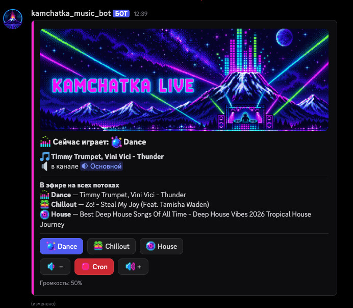

# 📻 Радио-бот Kamchatka Live для Discord

Бот — это участник вашего сервера. В выбранном текстовом канале постоянно висит **пульт с кнопками**, и пользоваться им может любой, кто видит этот канал:



Пульт оформлен в цветах логотипа: слева неоновая полоса (маджента, пока играет радио), сверху пиксельная шапка, на кнопках и в тексте — пиксельные эмодзи. У потока, который сейчас играет, двигается анимированный эквалайзер.

Что делают кнопки и пульт:

- **Кнопка потока** (Dance, Chillout, House): бот приходит в голосовой канал того, кто нажал, и включает этот поток. Чтобы переключиться на другой поток, просто нажмите другую кнопку. Кнопка играющего потока подсвечена.
- **⏹️ Стоп**: бот выключает радио и выходит из голосового канала.
- **🔉 − / 🔊 +**: громкость тише или громче для всех слушателей, шагом 10%.
- **Что играет:** на пульте видно, какой поток играет, какой трек на нём идёт и что сейчас звучит на остальных потоках. Всё это обновляется само каждые 15 секунд.

Ещё бот:
- сам переподключается, если связь с радио оборвалась;
- выключается сам, если в голосовом канале 5 минут никого нет;
- помнит, где стоит пульт и какая была громкость, даже после перезапуска.

> ℹ️ В списке участников сервера бот выглядит как обычный пользователь, только с пометкой **«ПРИЛОЖЕНИЕ»**. Сделать бота из обычного аккаунта Discord нельзя: правила Discord это запрещают, и за такое блокируют аккаунт.

---

## Шаг 1. Создайте бота в Discord и получите токен

1. Откройте <https://discord.com/developers/applications> и войдите в свой аккаунт Discord.
2. Нажмите **«Новое приложение»**, введите имя, поставьте галочку согласия и нажмите **«Создать»**. Это имя бот будет носить на сервере.
   - Если появляется ошибка «Нет доступа», подтвердите email в настройках Discord (Моя учётная запись) и попробуйте снова.
3. В меню слева откройте **«Бот»** (не «Общая информация»!).
   - Нажмите **«Сбросить токен»** (Reset Token), подтвердите и нажмите **«Копировать»**. Это и есть **токен**.
   - Токен выглядит примерно так: `MTI3NjQ5ODk...Nzg5.GaBcDe.k3J9...xYz`. Это длинная строка из трёх частей **через точку**.
   - ⚠️ Не путайте токен с **«Публичным ключом»** и **«ID приложения»** со страницы «Общая информация». Эти значения боту не подходят.
   - Discord показывает токен один раз. Если потеряете, просто снова нажмите «Сбросить токен».
4. Переключатели в разделе **Privileged Gateway Intents** оставьте выключенными.
5. По желанию загрузите на этой же странице **значок** и **баннер** бота — готовые картинки лежат в папке [`assets`](assets): `icon-volcano.png` и `banner-title.png`.

> ⚠️ **Токен — это пароль от бота.** Никому его не отправляйте и не выкладывайте в интернет. Файл `.env` с токеном в репозиторий не попадает — он указан в `.gitignore`. Если токен случайно попал к кому-то, нажмите «Сбросить токен» и вставьте новый в файл `.env`.

## Шаг 2. Впишите токен в файл `.env`

В папке бота скопируйте файл `.env.example` в `.env`, откройте его Блокнотом и вставьте токен вместо `PASTE_YOUR_TOKEN_HERE`:

```
TOKEN=ваш_токен
```

Можно писать и `DISCORD_TOKEN=ваш_токен`: бот понимает оба варианта.

## Шаг 3. Запустите бота

Скачайте **`KamchatkaRadioBot.exe`** со страницы **Releases** этого репозитория и положите в папку бота рядом с `.env`. Exe можно собрать и самому: `tools\build_exe.bat` (нужен Python 3.10+).

Дважды щёлкните **`KamchatkaRadioBot.exe`**. Откроется чёрное окно с журналом:

```
Радио-бот запускается. Чтобы выключить его, закройте это окно.
radio: Звук: ffmpeg ✓, Opus ✓, PyNaCl ✓, DAVE ✓
radio: Бот kamchatka_music_bot#3674 запущен. Серверов: 1
radio: Команды зарегистрированы на сервере «…»
```

- **Пока окно открыто, бот работает.** Окно можно свернуть. Если закрыть окно, бот выключится.
- Ставить ничего не нужно: всё, что нужно для звука, уже внутри exe.
- Если Windows покажет «Windows защитил ваш компьютер», нажмите **«Подробнее» → «Выполнить в любом случае»**. Это предупреждение появляется, потому что у программы нет платной цифровой подписи.
- Если что-то не так, окно не закроется само: там будет описание проблемы и подсказка, что делать.

> 💡 **Автозапуск вместе с Windows:** нажмите **Win+R**, введите `shell:startup` и нажмите Enter. В открывшуюся папку перетащите `KamchatkaRadioBot.exe` **правой кнопкой мыши** и выберите **«Создать ярлыки»**.

## Шаг 4. Добавьте бота на сервер

Если бот ещё не на сервере, откройте ссылку из журнала (строка «Ссылка, чтобы добавить бота на сервер»), выберите сервер и нажмите **«Авторизовать»**. Галочки с правами не снимайте.

Ссылку можно собрать и вручную — подставьте **ID приложения** со страницы «Общая информация»:

```
https://discord.com/oauth2/authorize?client_id=ID_ПРИЛОЖЕНИЯ&scope=bot+applications.commands&permissions=3230720
```

## Шаг 5. Поставьте пульт в нужный канал

1. **Если канал закрытый** (его видят не все), добавьте туда бота так же, как добавляете людей:
   - нажмите на шестерёнку рядом с каналом, затем откройте **Права доступа**;
   - нажмите **«+»** рядом с «Роли/участники» и выберите бота;
   - включите ему ✅ **Просматривать канал**, **Отправлять сообщения**, **Встраивать ссылки** и **Читать историю сообщений**;
   - сохраните.

   Если канал открыт для всех, ничего делать не нужно.
2. Зайдите в этот канал и напишите команду **`/radio-setup`**. Discord предложит её в списке, выберите и нажмите Enter.
3. В канале появится пульт. Готово!

Команда `/radio-setup` видна только администраторам сервера. Если поставить пульт в другой канал, старый пульт удалится сам.

**Кто может управлять радио?** Все, кто видит канал с пультом. Круг людей настраивается в «Правах доступа» канала.

> 💡 **Чтобы пульт не терялся в переписке**, запретите в «Правах доступа» канала роли `@everyone` **Отправлять сообщения**. Кнопки при этом продолжат работать у всех. Если всё же в канале переписываются, бот сам перенесёт пульт вниз через 30 секунд после последнего сообщения.

---

## Как пользоваться

1. **Зайдите в любой голосовой канал** на сервере.
2. Откройте канал с пультом и нажмите кнопку нужного потока. Бот придёт к вам в голосовой канал и начнёт играть.
3. Чтобы переключить поток, нажмите другую кнопку. Если нажать кнопку из другого голосового канала, бот перейдёт туда.
4. Чтобы выключить радио, нажмите **⏹️ Стоп**. Бот выйдет из голосового канала.

Если нажать кнопку потока, не находясь в голосовом канале, бот подскажет, что сначала нужно туда зайти. Эту подсказку увидит только тот, кто нажал.

### Команды

Пульта обычно хватает, но есть и команды. Ответы на них видит только тот, кто их написал.

| Команда | Что делает |
|---|---|
| `/radio-setup` | Поставить пульт в текущий канал (только для администраторов) |
| `/radio` | Открыть личную копию пульта в любом канале |
| `/radio-play поток:` | Включить нужный поток (Discord предложит выбрать из списка) |
| `/radio-stop` | Выключить радио |
| `/radio-now` | Показать, что сейчас играет |
| `/radio-volume уровень:` | Точная громкость от 1 до 100 |

> 💡 Каждый слушатель может сделать бота тише или громче только для себя: щёлкните по боту правой кнопкой в голосовом канале и выберите **«Громкость пользователя»**.

---

## Если что-то не работает

Посмотрите в окно бота: почти всегда там написано, в чём дело. Тот же журнал сохраняется в файл **`data\bot.log`**, так что его можно открыть и после закрытия окна.

| Проблема | Что делать |
|---|---|
| «вместо токена бота вставлен Публичный ключ…» | В `.env` вставлено не то значение. Возьмите токен на странице **«Бот»** → «Сбросить токен» (шаг 1) |
| «Discord не принял токен» | Токен устарел. Сбросьте его (шаг 1) и вставьте новый в `.env` |
| В строке «Звук:» есть ✗ | Exe собран неправильно. Напишите разработчику и пришлите эту строку |
| Нет команды `/radio-setup` | Её видят только администраторы. Убедитесь, что бот запущен, и перезапустите Discord (**Ctrl+R**). В окне бота должна быть строка «Команды зарегистрированы на сервере …» |
| `/radio-setup` пишет «боту не хватает прав» | Добавьте бота в права доступа канала и включите перечисленные права (шаг 5) |
| Кнопки пишут «Взаимодействие не удалось» | Бот выключен. Запустите `KamchatkaRadioBot.exe` |
| Пульт пропал | Его кто-то удалил. Напишите `/radio-setup` в нужном канале ещё раз |
| Кнопка пишет «Сначала зайдите в голосовой канал» | Бот приходит к тому, кто нажал. Зайдите в голосовой канал и нажмите ещё раз |
| «Нет прав подключаться или говорить» | В правах доступа голосового канала разрешите боту **Подключаться** и **Говорить** |
| Бот в канале, но его не слышно | Проверьте громкость бота у себя (правая кнопка по боту → Громкость пользователя) и на пульте. Если в окне «Поток … оборвался, переподключаюсь», значит, временно недоступен радиосервер: бот подключится сам |
| Бот сам вышел из канала | Так задумано: он выходит, если в канале 5 минут никого нет. Время меняется в `.env` (см. «Настройки») |
| На пульте обычные эмодзи вместо пиксельных | Бот не смог загрузить свои эмодзи в Discord. Причина — в журнале, в строке «Не удалось загрузить эмодзи». Пульт при этом работает как обычно |
| Антивирус ругается на exe | Это ложное срабатывание, обычное для программ, собранных из Python. Добавьте файл в исключения антивируса |

---

## Настройки

Настройки хранятся в файле **`.env`** (откройте его Блокнотом). После изменения перезапустите бота: закройте окно и снова откройте exe. Все строки, кроме токена, необязательны.

| Параметр | Что значит | По умолчанию |
|---|---|---|
| `TOKEN` или `DISCORD_TOKEN` | Токен бота | — |
| `PLAYLIST` | Какой плейлист из папки `playlists` использовать | `kamchatka.pls` |
| `DEFAULT_VOLUME` | Начальная громкость, от 1 до 100. Дальше бот помнит громкость, выставленную кнопками | `50` |
| `AUTO_LEAVE_SECONDS` | Через сколько секунд выключиться, если в канале никого нет (`0` — никогда) | `300` (5 минут) |

Пример `.env` со всеми настройками:

```
TOKEN=ваш_токен
PLAYLIST=kamchatka.pls
DEFAULT_VOLUME=50
AUTO_LEAVE_SECONDS=300
```

### Оформление пульта

Картинки пульта лежат в папке `bot\assets`:

- `panel-header.png` — шапка пульта. Если удалить файл, вместо шапки будет название радио текстом.
- `emoji\` — пиксельные эмодзи (PNG или GIF, 128×128, до 256 КБ). Бот сам загружает их в своё приложение Discord при запуске — их видно в Developer Portal на вкладке **«Emojis»**. Если заменить картинку, при следующем запуске бот заменит и эмодзи. Эмодзи потока подбирается по слову в его названии: `radio_dance`, `radio_chill`, `radio_house`.

После обновления бот сам один раз переставляет старый пульт на новый в том же канале.

### Какой формат плейлиста лучше?

Все три файла в папке `playlists` содержат одни и те же три потока, и бот умеет читать любой из них.

- **`kamchatka.pls`** — **рекомендуется** и выбран по умолчанию: в нём есть и ссылки, и названия потоков.
- `kamchatka.xspf` — тоже с названиями, но ссылки ведут на другой порт сервера (8100 вместо 8103). Оба адреса рабочие, так что это запасной вариант.
- `kamchatka.m3u` — только ссылки без названий. Бот возьмёт названия из адреса (Dance, Chillout, House), но заголовок пульта будет просто «Kamchatka».

Если радио поменяет адреса, скачайте новый плейлист, положите его в папку `playlists` рядом с exe, укажите его имя в `PLAYLIST` и перезапустите бота.

---

## Запуск через Docker (по желанию)

Exe удобен, пока компьютер включён и окно открыто. Вариант с Docker работает в фоне без окна и сам запускается вместе с Docker Desktop. Шаги 1, 2, 4 и 5 те же самые, меняется только запуск.

1. Установите **Docker Desktop**: <https://www.docker.com/products/docker-desktop/>. Оставьте галочку **«Use WSL 2»**, после установки перезагрузите компьютер, запустите Docker Desktop и дождитесь надписи **Engine running**.
2. Дважды щёлкните **`start.bat`**. В первый раз бот соберётся за 1–3 минуты, потом откроется журнал. Окно можно закрыть, бот останется работать.
3. Остановить бота — `stop.bat`, посмотреть журнал — `logs.bat`.

**macOS и Linux.** Нужен Docker (Docker Desktop, OrbStack или Colima). В папке бота:

```bash
cp .env.example .env           # и впишите в .env токен
docker compose up -d --build   # собрать и запустить в фоне
docker compose logs -f         # журнал (Ctrl+C — выйти, бот продолжит работать)
docker compose down            # остановить
```

Если Docker установлен через Homebrew вместе с Colima, пишите `docker-compose` (через дефис) вместо `docker compose`.

В Docker бот хранит память о пульте и громкости не в папке `data`, а в томе Docker `radio-data`.

> ⚠️ Не запускайте exe и Docker одновременно: получится два бота с одним токеном, и они будут мешать друг другу.

---

## Что лежит в папке

```
├── KamchatkaRadioBot.exe             — бот для Windows: скачать из Releases (в репозитории его нет)
├── .env.example                      — образец настроек: скопируйте в .env
├── .env                              — ваш токен и настройки (создаёте сами, в git не попадает)
├── playlists\                        — плейлисты радио (.pls, .m3u, .xspf)
├── data\                             — здесь бот запоминает пульт и громкость (появится сам)
├── start.bat / stop.bat / logs.bat   — запуск через Docker на Windows (по желанию)
├── Dockerfile, docker-compose.yml    — описание контейнера Docker
├── bot\                              — исходный код бота (Python, discord.py)
│   └── assets\                       — шапка пульта и пиксельные эмодзи
├── assets\                           — значок, баннер и скриншот пульта
├── tools\build_exe.bat               — собрать exe из исходного кода (нужен Python)
├── tools\make_emoji.py               — перерисовать пиксельные эмодзи (нужен Pillow)
└── requirements.txt                  — библиотеки Python
```

Технические подробности: бот написан на Python и discord.py 2.7 и поддерживает сквозное шифрование голосовых каналов Discord (DAVE). Пульт сделан на Components V2, эмодзи — эмодзи приложения (работают на любом сервере без Nitro). Звук получается из радиопотока через ffmpeg, который упакован внутрь exe. Названия треков бот берёт из статуса сервера Icecast (`status-json.xsl`).

---

## Лицензия

MIT — смотрите файл [LICENSE](LICENSE).
